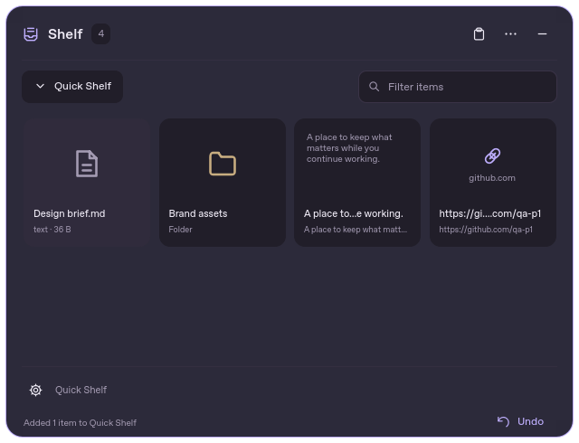

# Arcade Shelf

A floating workspace for files, folders, images, text, and links. Collect what
you need, keep working, then drag it into another application or send it to an
installed Arcade tool.

**Development milestone, version 0.1.0.** This repository contains working C++20
and Qt 6 software. It is under active verification; it is not a stable release.
See [current status](docs/STATUS.md) for tested behavior and remaining work.



## Use Shelf

1. Start `arcade-shelf`. A compact capsule appears.
2. Drop files, folders, browser links, or text on the capsule. Existing files stay
   where they are; Shelf stores references.
3. Click the capsule to expand. Select items, drag them to another application,
   or use the context menu to open, reveal, copy, reorder, or remove them.
4. Use the collection menu to create, rename, switch, pin, reorder, and delete
   shelves. Temporary collections and named collections survive restarts.

Undo removes the last addition. Removing a reference never deletes its original.
Raw images and temporary outputs are copied into private Shelf storage. Missing
originals are marked unavailable when a shelf is refreshed.

The surface supports dark, light, and system themes, multiple selection,
collection filtering, resizing, edge docking, reduced motion, optional topmost
behavior, and preferences. Desktop capabilities depend on the window system:
read the [Wayland decision](docs/ARCHITECTURE.md#wayland-surface-decision).
Moving near an edge snaps the shelf on supported desktops. Hover over its tab
to peek without taking keyboard focus; click to work in it, and press Escape to
return to the tab. [Native surface notes](docs/NATIVE_SURFACES.md) describe
fullscreen handling, system materials and compositor-specific limits.

## Build and run

Requirements: CMake 3.25+, a C++20 compiler, Qt 6.8+ with Core, Gui, Widgets,
Quick, QuickControls2, Network, Sql, Svg, Test, the SQLite driver, and runtime QML
modules. Linux also uses Qt DBus and X11 when available. No Electron, bundled
browser, account, or telemetry is used.

On Debian with Qt 6.8 packages:

```sh
sudo apt install cmake ninja-build g++ qt6-base-dev qt6-declarative-dev \
  qt6-svg-dev qt6-wayland libqt6sql6-sqlite libx11-dev \
  qml6-module-qtquick qml6-module-qtquick-controls qml6-module-qtquick-layouts \
  qml6-module-qtquick-window qml6-module-qtquick-templates qml6-module-qtqml-workerscript
cmake -S . -B build -G Ninja -DCMAKE_BUILD_TYPE=Release
cmake --build build --parallel 4
./build/arcade-shelf
```

For other platforms, use a Qt 6.8+ SDK and set `CMAKE_PREFIX_PATH` to its root.
Windows uses MSVC; macOS uses Clang. Platform CI and package scripts are included;
native Windows/macOS interaction still needs verification.

```sh
./build/arcade-shelf --show
./build/arcade-shelf --add /absolute/path/to/file
./build/arcade-shelf --background
./build/arcade-shelf --settings
./build/arcade-shelf --status
./build/arcade-shelf --quit
```

A second launch forwards to the resident instance. `--background` starts the
service without showing a window. `--version` and `--arcade-manifest` have no
registration or filesystem side effects. Shelf deliberately does not implement
one-shot `--arcade-invoke`.

## Keyboard

| Shortcut | Action |
|---|---|
| Ctrl+Alt+S | Default global Shelf shortcut; configurable, platform dependent |
| Arrows / Shift+arrows | Navigate / extend selection |
| Ctrl/Cmd+A | Select visible items |
| Ctrl/Cmd+C | Copy selected content |
| Ctrl/Cmd+V | Collect explicitly pasted clipboard content |
| Ctrl/Cmd+F | Filter the current shelf |
| Ctrl/Cmd+Z | Undo the last addition |
| Enter | Open an item; confirm an explicit picker selection |
| Space | Preview through Look when its compatible action is installed |
| Delete | Remove selected items from Shelf |
| Escape | Clear a filter, dismiss, or cancel a picker |

Standard clipboard shortcuts are used only inside Shelf. They are never
registered globally. Global shortcut collisions are checked against cached
Arcade Link metadata. Where the portal cannot bind a shortcut, a compositor
binding can run `arcade-shelf --toggle`.

## Arcade apps

Shelf exposes `shelf.add`, `shelf.show`, and `shelf.pick` through frozen Arcade
Link v1. A picker returns only what the user explicitly selects. Installed peers
are discovered by capabilities; unavailable integrations are hidden.

Look owns preview and inspection; Lens owns capture, image recognition, and
pins; Box owns transformations and pipelines; Clipboard owns explicit picking
and eligible device delivery. Optional Find actions appear only when Find
actually advertises them. Wheel and Tools also need the included shared
onboarding patches before their existing app allowlists recognize Shelf.

See [the contracts and ownership rules](docs/ARCADE_LINK.md),
[ecosystem verification](docs/ECOSYSTEM_VERIFICATION.md), and
[reviewable onboarding patches](docs/INTEGRATION_PATCHES.md).

## Data and limits

Metadata and preferences live in SQLite under Qt's per-user application-data
directory (`qa-p1/ArcadeShelf`). `ARCADE_SHELF_HOME` overrides Shelf's profile;
`ARCADE_HOME` independently overrides Link's registry, runtime, and handoffs.
Tests must isolate both.

The default owned-content quota is 512 MiB. Exported temporary handoffs have a
separate budget of the same size and a 24-hour lifetime; metadata and SQLite
overhead are additional. Temporary shelf items expire after 30 days by default
at startup; pinned collections are retained. Retention 0 disables expiration.
Requests accept at most 1,000 values, 256 KiB inline text, and up to 16 MiB text
through private handoffs. Thumbnails are generated lazily and their memory cache
defaults to 64 MiB with at most two decoder workers. The saved
`thumbnailQuotaBytes` setting bounds this cache; zero disables it. Qt Quick's
visible textures are additional memory. There is no idle filesystem polling or
clipboard history.

## Verify and package

```sh
QT_QPA_PLATFORM=offscreen QT_QUICK_BACKEND=software \
  ctest --test-dir build --output-on-failure
python3 tests/process_smoke.py --binary build/arcade-shelf
python3 scripts/check-vendor.py
```

Linux native drag tests require Xvfb and xdotool. Wayland startup can be tested
with headless Weston; real Hyprland/Nautilus behavior requires a desktop session.
See [testing instructions](docs/TESTING.md), [packaging](docs/PACKAGING.md),
[architecture](docs/ARCHITECTURE.md), and [changelog](CHANGELOG.md).

Shelf is [MIT licensed](LICENSE). Qt and other dependencies retain their own
licenses; see [dependency provenance](THIRD_PARTY_NOTICES.md). Development packages
are unsigned. No stable releases are published by the CI workflow.
