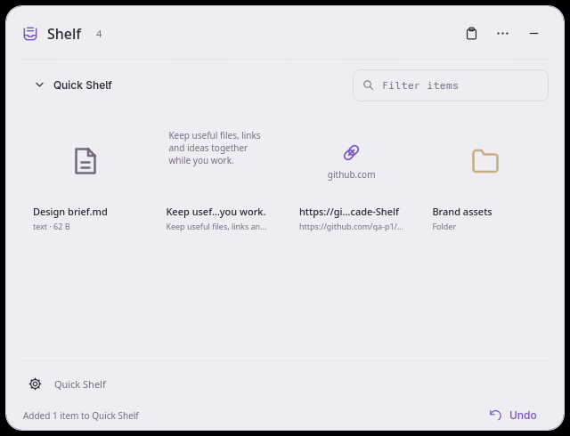

<p align="center">
  
</p>

<h1 align="center">Arcade Shelf</h1>

<p align="center">A floating workspace for desktop content.</p>

<p align="center">
  <a href="https://github.com/qa-p1/Arcade-Shelf/releases/latest"></a>
  <a href="https://github.com/qa-p1/Arcade-Shelf/actions/workflows/build.yml"></a>
</p>

---

Arcade Shelf is a floating place to collect files, folders, images, text and links while you work. Keep useful references together, then drag or send selected content to another app. It is written in C++20 with Qt 6 and Qt Quick: no Electron, bundled browser, account, or telemetry.

It runs on **Linux** (x86_64; X11 and Wayland), **Windows** (x64) and **macOS** (universal: Apple Silicon and Intel). Shelf's tested desktop behavior is on Hyprland; native Windows/macOS interaction still needs verification.

<p align="center"></p>

## Download and install

Download the file for your system from [Releases](https://github.com/qa-p1/Arcade-Shelf/releases). Or install it from **[Arcade Tools](https://github.com/qa-p1/Arcade-tools) → Apps**, which can also update and remove it.

| Platform | File | How to install |
|---|---|---|
| Linux x86_64 | `Arcade-Shelf-<version>-x86_64.AppImage` | Run it. The first run asks **Install Arcade Shelf?** and installs to `~/Applications/Arcade/`, adds a menu entry, an `arcade-shelf` command in `~/.local/bin` and an optional start at login. **Just run it once** skips installing. |
| Windows x64 | `Arcade-Shelf-<version>-windows-x64.exe` | Run the per-user installer; no admin needed. Adds a Start menu entry, an optional desktop shortcut and start at login, and puts `arcade-shelf` on PATH. |
| macOS (universal) | `Arcade-Shelf-<version>-macos-universal.dmg` | Open the dmg and drag Arcade Shelf to Applications. Run from the dmg or Downloads, it offers to move itself to Applications. |

- Scripted install: `arcade-shelf --install --silent` (add `--no-launch`, or `--channel stable|nightly`). `--repair` repairs the integration; `--integration-status` prints it as JSON.
- If `~/.local/bin` is not on your PATH, Shelf shows the exact line to add for your shell.
- Builds are unsigned. On Windows, SmartScreen may warn: choose **More info → Run anyway**. On macOS the app is not notarized: Control-click or right-click it and choose **Open** the first time.
- If FUSE is missing on Linux, run the AppImage with `--appimage-extract-and-run`.

A version tag publishes a GitHub release with the three packages, `arcade-release.json` and `SHA256SUMS.txt`. See [Install and start Arcade Shelf](docs/user/getting-started.md) and [packaging](docs/PACKAGING.md).

## Features

- **Collect anything:** drop files, folders, browser links or text onto the capsule or expanded panel, or press Ctrl+V to collect supported clipboard content. Ctrl+Z undoes the last addition; duplicates are skipped.
- **References, not copies:** existing files and folders are stored as references and never moved or copied; a missing original is marked unavailable. Image data and temporary outputs from Arcade actions are copied into Shelf's private storage.
- **Collections:** a temporary **Quick Shelf** plus named collections you can rename, pin, reorder or delete. Unpinned temporary items expire after 30 days by default.
- **Select and filter:** multi-select with Shift/Ctrl+arrows, Ctrl+A, and filter by name, path or text with Ctrl+F.
- **Hand off:** drag items to another app, copy them with Ctrl+C, open or reveal them. Removing an item never deletes the original file.
- **Dock and peek:** drag the capsule to a screen edge to dock it as a tab; hover to peek without taking focus.
- **Settings:** system, light and dark themes, reduced motion, optional always-on-top and start at login.

More in [Collect and use items in Shelf](docs/user/features.md).

<p align="center"></p>

## Works with other Arcade apps

Shelf works on its own. It connects to other installed Arcade apps automatically over Arcade Link, **without needing Arcade Tools**. Installed peers are discovered by capabilities and unavailable integrations are hidden. Manage the master connection and per-app toggles in **Settings → Connected apps**.

| App | What Shelf does with it |
|---|---|
| Arcade Box | Run a compatible Box transformation or saved pipeline on selected content; returned temporary files can be collected. |
| Arcade Clipboard | Open Clipboard's picker, or send eligible content to your devices. |
| Arcade Find | Find's **Add to Shelf** collects search results as references. **Search in Find** for an item; **Find matching files** for text. |
| Arcade Lens | Run a compatible capture, recognition or analysis action; Shelf can keep returned images or outputs. |
| Arcade Look | **Preview** or **Inspect** selected files, or press **Space**. |
| Arcade Wheel | Use a Shelf action from a Wheel slot; Wheel can open Shelf or refer to a named collection. |
| Arcade Tools | Install, update or remove Shelf from its **Apps** tab. |

Shelf exposes `shelf.add`, `shelf.show` and `shelf.pick`. A picker returns only what you explicitly select. Actions with effects such as sending content, writing files, changing the clipboard or persisting data ask you to confirm first.

When Arcade Tools is running, its tray icon hosts Shelf's menu, including **New shelf…** and **Show shelf**. Tools can also restart Shelf, rebind its global shortcut and back up portable settings. When Tools disconnects, Shelf's own icon returns immediately; turning off Connected apps also returns the icon.

See [Use Arcade Shelf with other apps](docs/user/with-other-apps.md), [the contracts and ownership rules](docs/ARCADE_LINK.md), [ecosystem verification](docs/ECOSYSTEM_VERIFICATION.md) and [ecosystem onboarding](docs/ONBOARDING.md).

## Usage

Start Shelf from the app launcher or run `arcade-shelf`. A compact capsule appears; click it to expand the active collection. The default global shortcut is **Ctrl+Alt+S** (⌃⌥S on macOS); change it in **Settings → Trigger**. Clipboard shortcuts are used only inside Shelf. Where the portal cannot bind a shortcut, a compositor binding can run `arcade-shelf --toggle`.

| Key | Action |
|---|---|
| Space | Preview the selection through Look |
| Enter | Open the focused item, or confirm a picker selection |
| Ctrl+C / Ctrl+V | Copy selected content / collect clipboard content |
| Ctrl+Z | Undo the last addition |
| Ctrl+F | Filter the collection |
| Ctrl+A | Select all visible items |
| Delete / Backspace | Remove from the collection (never the original) |
| Escape | Cancel a picker, clear the filter, or close the panel |

See the [shortcut reference](docs/user/shortcuts.md).

### Command line

```sh
arcade-shelf --show
arcade-shelf --toggle
arcade-shelf --add /absolute/path/to/file
arcade-shelf --background
arcade-shelf --settings
arcade-shelf --status
arcade-shelf --restart
arcade-shelf --quit
```

A second launch forwards to the resident instance. `--background` starts the service without showing a window. `--status` prints JSON without opening a window. `--version` and `--arcade-manifest` have no registration or filesystem side effects. Shelf deliberately does not implement one-shot `--arcade-invoke`.

Packaged AppImages and macOS bundles also accept `--install [--silent] [--no-launch] [--channel stable|nightly]`, `--uninstall [--silent] [--remove-data]`, `--repair`, and `--integration-status`. Development builds never install themselves. Windows uses its per-user installer and receipt-recorded uninstaller.

## Settings and data

Metadata and preferences live in SQLite under Qt's per-user application-data directory (`qa-p1/ArcadeShelf`). `ARCADE_SHELF_HOME` overrides Shelf's profile; `ARCADE_HOME` independently overrides Link's registry, runtime, and handoffs. Tests must isolate both.

**Settings → About → Backup and restore** exports collections and preferences. Shelf shows the owned-content size and asks before including it; referenced original files are never copied. Tools backups include metadata and preferences only. Restore validates the archive and backs up the current database under the profile's `backups/` folder first. Window geometry and machine-specific login entries are not part of the portable backup.

The default owned-content quota is 512 MiB. Exported temporary handoffs have a separate budget of the same size and a 24-hour lifetime; metadata and SQLite overhead are additional. Temporary shelf items expire after 30 days by default at startup; pinned collections are retained. Retention 0 disables expiration. Requests accept at most 1,000 values, 256 KiB inline text, and up to 16 MiB text through private handoffs. Thumbnails are generated lazily and their memory cache defaults to 64 MiB with at most two decoder workers. The saved `thumbnailQuotaBytes` setting bounds this cache; zero disables it. Qt Quick's visible textures are additional memory. There is no idle filesystem polling or clipboard history.

## Uninstall

- **Linux:** run `arcade-shelf --uninstall`, use the launcher's **Uninstall** action, or remove Shelf in Arcade Tools.
- **Windows:** **Settings → Apps** (Apps & features), or Arcade Tools.
- **macOS:** `arcade-shelf --uninstall` removes the installation recorded in its receipt, or remove Shelf in Arcade Tools.

Your settings stay unless you choose to remove them (`--remove-data`).

## Platform notes

- Shelf's tested desktop behavior is on Hyprland. Other Linux desktops, fullscreen behavior and multi-monitor/DPI handling still need real-desktop verification.
- Linux also uses Qt DBus and X11 when available. Linux may ask you to approve the global shortcut; if your desktop cannot bind it, the status message explains the alternative.
- Platform CI and package scripts are included for Windows and macOS; native Windows/macOS interaction still needs verification.

## Build from source

Requirements: CMake 3.25+, a C++20 compiler, Qt 6.8+ with Core, Gui, Widgets, Quick, QuickControls2, Network, Sql, Svg, Concurrent, Test, the SQLite driver, and runtime QML modules.

On Debian with Qt 6.8 packages:

```sh
sudo apt install cmake ninja-build g++ qt6-base-dev qt6-declarative-dev \
  qt6-svg-dev qt6-wayland libqt6sql6-sqlite libx11-dev \
  qml6-module-qtquick qml6-module-qtquick-controls qml6-module-qtquick-layouts \
  qml6-module-qtquick-window qml6-module-qtquick-templates qml6-module-qtqml-workerscript
cmake -S . -B build -G Ninja -DCMAKE_BUILD_TYPE=Release
cmake --build build --parallel 4
./build/arcade-shelf
```

For other platforms, use a Qt 6.8+ SDK and set `CMAKE_PREFIX_PATH` to its root. Windows uses MSVC; macOS uses Clang.

Test:

```sh
QT_QPA_PLATFORM=offscreen QT_QUICK_BACKEND=software \
  ctest --test-dir build --output-on-failure
python3 tests/process_smoke.py --binary build/arcade-shelf
python3 scripts/check-vendor.py
```

Linux native drag tests require Xvfb and xdotool. Wayland startup can be tested with headless Weston; real Hyprland/Nautilus behavior requires a desktop session. See [testing instructions](docs/TESTING.md).

## Documentation

- [User guide](docs/user/): [getting started](docs/user/getting-started.md), [features](docs/user/features.md), [shortcuts](docs/user/shortcuts.md), [FAQ](docs/user/faq.md), [troubleshooting](docs/user/troubleshooting.md)
- [Architecture](docs/ARCHITECTURE.md), [native surfaces](docs/NATIVE_SURFACES.md)
- [Arcade Link](docs/ARCADE_LINK.md), [ecosystem verification](docs/ECOSYSTEM_VERIFICATION.md), [onboarding](docs/ONBOARDING.md)
- [Testing](docs/TESTING.md), [packaging](docs/PACKAGING.md)
- [Status](docs/STATUS.md)
- [Changelog](CHANGELOG.md)

## License

Shelf is [MIT licensed](LICENSE). Qt and other dependencies retain their own licenses; see [dependency provenance](THIRD_PARTY_NOTICES.md).

---

<p align="center">
  Part of the <b>Arcade</b> suite:
  <a href="https://github.com/qa-p1/Arcade-Find">Find</a> ·
  <a href="https://github.com/qa-p1/Arcade-lens">Lens</a> ·
  <a href="https://github.com/qa-p1/Arcade-look">Look</a> ·
  <a href="https://github.com/qa-p1/Arcade-box">Box</a> ·
  <a href="https://github.com/qa-p1/Arcade-clipboard">Clipboard</a> ·
  <a href="https://github.com/qa-p1/Arcade-Shelf">Shelf</a> ·
  <a href="https://github.com/qa-p1/Arcade-wheel">Wheel</a> ·
  <a href="https://github.com/qa-p1/Arcade-tools">Tools</a> ·
  <a href="https://github.com/qa-p1/Arcade-catalog">Docs</a>
</p>
